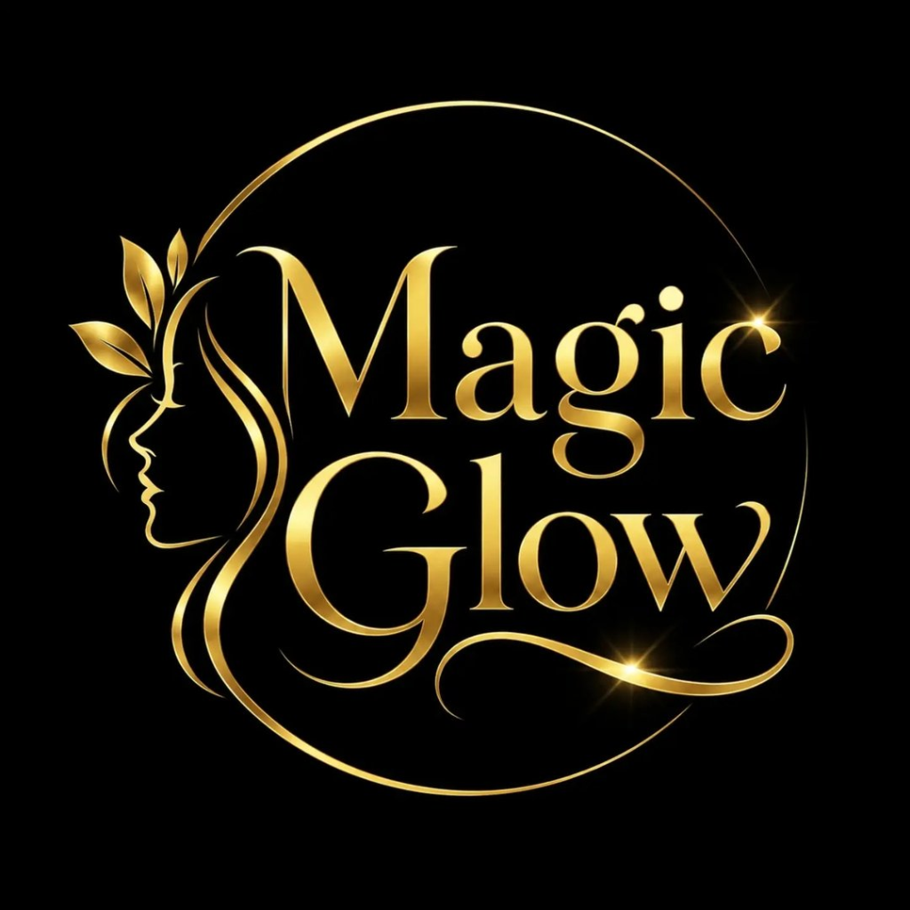

<div align="center">

  

  # MAGIC GLOW
  ### *Haute Skincare & 24K Gold Cellular Rituals*
  
  **"Awaken Your Glow"**

  [](https://opensource.org/licenses/MIT)
  [](https://github.com/ASH1351/magic-glow)
  [](https://github.com/ASH1351/magic-glow)

</div>

---

## ✦ Brand Overview

**Magic Glow** is a premier luxury face-care and skincare house alchemizing certified 24K pure colloidal gold, ancient Ayurvedic botanicals (Kashmiri Mongra Saffron, Kannauj Damask Rose), and Swiss clinical biotechnology. 

Crafted with the visual weight, restraint, and refinement of high-end beauty houses (Chanel Beauty, Dior Skincare, Augustinus Bader), the experience sits upon a canvas of pure black with metallic polished gold foil (`#D4AF37`) accents and atmospheric golden radiance.

---

## ✦ Key Features

- **Gold Line-Art SVG Preloader**: Handcrafted SVG stroke-drawing animation reproducing the logo silhouette, leaves, and sparkle bursts.
- **Hero Canvas Particle Engine**: Custom 60fps HTML5 canvas system rendering drifting 4-pointed gold stars with mouse repulsion and `prefers-reduced-motion` compliance.
- **14 Signature Formulations**: Complete catalog of 14 formulations with INR pricing, volume switches, active ingredients, and clinical efficacy metrics.
- **Interactive Skincare Routine Quiz**: Real-time diagnostic selector for skin types (Oily, Dry, Combination, Sensitive) and concerns, generating tailored AM & PM step-by-step visual roadmaps with 1-click bundle checkout.
- **Draggable Before / After Split Slider**: Interactive touch- and mouse-responsive slider displaying 28-day clinical results.
- **Hero Spotlight**: Dedicated showcase for the *Midnight Repair Night Cream* with interactive active ingredient hotspots and barrier restoration stats.
- **Complete E-Commerce Architecture**:
  - Slide-in Cart Drawer with dynamic `₹999` free luxury shipping progress tracker.
  - Wishlist Drawer with instant "Move to Bag" capability.
  - Promo Code Engine (`GLOW10` for 10% privilege savings).
  - Live search modal with instant query filtering and keyboard shortcuts (`/` or `Ctrl+K`).
  - Checkout modal with address validation and celebratory order confirmation.
  - Floating WhatsApp concierge for direct personal consultations.
  - Mobile bottom sticky navigation bar.

---

## ✦ Project Structure

```
magic-glow/
├── assets/
│   ├── css/
│   │   └── style.css            # Master luxury stylesheet & design tokens
│   ├── images/
│   │   └── logo.png             # Authentic brand logo
│   └── js/
│       ├── app.js               # Application engine, drawers, quiz & commerce state
│       ├── particles.js         # Canvas particle engine for hero stars
│       └── products-data.js     # Master 14-product catalog & category taxonomy
├── index.html                   # Primary luxury storefront
├── server.js                    # Lightweight development server
├── .gitignore                   # Ignored files
└── README.md                    # Project documentation
```

---

## ✦ Quick Start

Run locally with Node.js:

```bash
# Clone the repository
git clone https://github.com/ASH1351/magic-glow.git

# Enter the project directory
cd magic-glow

# Start the preview server
node server.js
```

Open your browser at **[http://localhost:3000](http://localhost:3000)**.

*(Or simply double-click `index.html` in any modern web browser).*

---

## ✦ Technology Stack

- **Markup**: Semantic HTML5 with Schema.org JSON-LD structured data.
- **Styling**: CSS3 with custom luxury design tokens, glassmorphism, metallic gold gradients, and fluid typography (`clamp()`).
- **Scripting**: Pure modern vanilla JavaScript (ES6+), zero heavy framework bloat.
- **Icons**: Font Awesome 6.
- **Typography**: Cormorant Garamond, Jost, and Pinyon Script via Google Fonts.

---

<div align="center">
  <p>© 2026 MAGIC GLOW LUXURY BEAUTY HOUSE. ALL RIGHTS RESERVED.</p>
</div>
